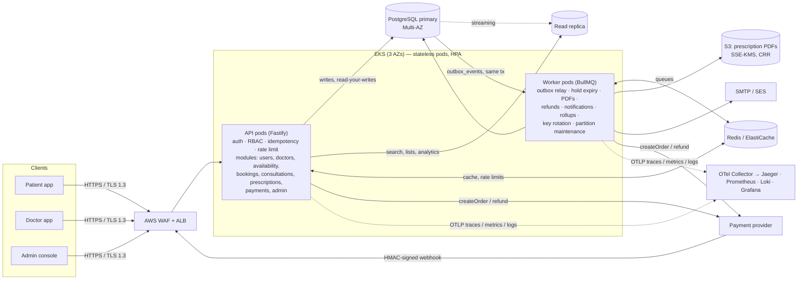
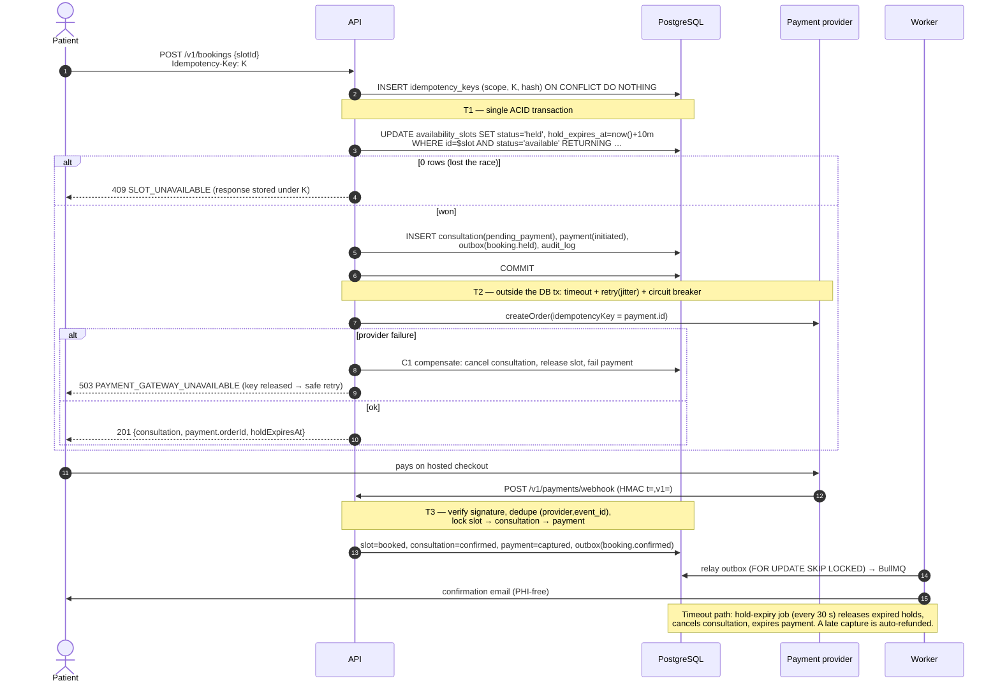
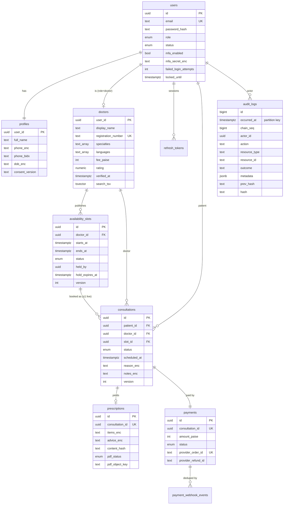

# Architecture — Amrutam Telemedicine Backend

> Scope: auth/MFA/RBAC, doctor availability & booking, consultation lifecycle & prescriptions,
> discovery search, compliance & audit, admin analytics.
> Targets: **100k consultations/day**, **p95 < 200 ms reads / < 500 ms writes**, **99.95 % availability**.

## 1. Capacity model

| Quantity | Derivation | Design target |
|---|---|---|
| Bookings | 100k/day → 1.2/s average; 80 % within 12 day-time hours, ×3 peak hour | **~7 bookings/s peak** |
| Writes | ~10 writes per consultation lifecycle (hold, webhook, start, Rx, complete, audit…) | **~70 writes/s peak → design 200/s** |
| Reads | ~20 discovery/slot reads per booking + dashboards | **~300 reads/s peak → design 1,000/s** |
| Data | 36.5 M consultations/yr; ~20 audit rows each | **~730 M audit rows/yr → partitioned** |

These are modest numbers for PostgreSQL. The hard parts are **correctness under contention** (popular
doctors' slots), **idempotency** across retries, and **compliance**. Measured locally (one API
container, Docker Desktop): reads **p95 4.5 ms @ 150 rps**; contended writes **p95 61 ms @ 40 rps**
with zero 5xx (`load/`).

## 2. High-level architecture & data flow

**Request path.** WAF/ALB → API pod. The pod runs these hooks in order:
1. Authenticate the JWT and check session revocation in Redis.
2. Authorize against the RBAC matrix (deny by default) and enforce MFA for clinicians and admins.
3. Apply the per-user or per-IP rate limit (Redis).
4. Validate the request with Zod (strict schemas).
5. Claim the `Idempotency-Key` (Postgres).
6. Run the handler.

The service performs the business transaction. It writes domain events to `outbox_events` **in the same transaction**. Workers relay the events to queues for asynchronous work.

**Code structure.** `src/modules/<domain>/{routes,service,schemas}`. Each service receives its collaborators through constructor injection, and `src/container.ts` is the single composition root. Tests build the same graph with fakes for the payment gateway, storage and mailer.

## 3. Booking flow (saga)

## 4. Data model (ER)

Support tables are `idempotency_keys`, `outbox_events`, `payment_webhook_events` and `analytics_daily`. Correctness is enforced in the schema itself:
- `EXCLUDE USING gist (doctor_id WITH =, tstzrange(starts_at, ends_at) WITH &&)` prevents overlapping slots.
- A partial unique index allows only one live consultation per slot.
- CHECK constraints keep holds consistent.
- Triggers make `audit_logs` append-only.

## 5. API

REST under `/v1`, described by OpenAPI 3.1 (`docs/openapi.yaml`, served at `/docs`). The spec is generated from the same Zod schemas that validate requests, and CI fails if it drifts.
- **Errors:** RFC 7807 `application/problem+json` with a stable `code`.
- **Writes:** every mutating call requires `Idempotency-Key`.
- **Lists:** opaque keyset cursors.
- **Concurrency on consultations:** `expectedVersion` gives optimistic concurrency.

## 6. Retry & backoff

| Where | Policy |
|---|---|
| DB transactions | Retries on `40001`, `40P01` and `55P03`: up to 3, full-jitter backoff of 20–500 ms (`withTransaction`). The transaction body is side-effect free. |
| Payment provider | 2 s timeout per attempt and 2 retries with full jitter of 100 ms–1 s, only for retryable errors (a decline is never retried). A circuit breaker opens at ≥50 % errors (minimum 10 calls in 30 s) and goes half-open after 15 s. Provider-side idempotency key = `payment.id`. |
| Background jobs | 5 attempts with exponential backoff (2 s → 32 s), then a **dead-letter queue** with an alert. |
| Outbox relay | Polls every 500 ms and backs off 2 s on error. At-least-once delivery, made duplicate-free by deterministic job ids (`outbox-<id>-<job>`). |
| Inbound webhooks | An unknown order returns 409, so the provider redelivers. Duplicates return 200 `duplicate`. |
| Clients | `Retry-After` on 503/423/409-in-progress. A retry with the **same** Idempotency-Key is always safe. |
| Redis / S3 | Redis fails fast (no offline queue) with a reconnect backoff of ≤5 s. The S3 SDK makes 3 attempts. |

## 7. Data partitioning

- **`audit_logs`** (largest table) is range-partitioned **monthly** on `occurred_at` (implemented):
  - `ensure_audit_partition()` plus a daily job create partitions three months ahead, with a DEFAULT partition as a safety net.
  - Retention means detaching old partitions and archiving them to S3/Glacier; no `DELETE` is ever issued.
- **`consultations`/`payments`** are about 36 M rows/year. The indexes `(patient_id, scheduled_at)` and `(doctor_id, scheduled_at)` keep hot queries index-only.
  - Next step at roughly 100 M rows: monthly partitions on `scheduled_at`, with the PK becoming `(id, scheduled_at)`, done expand/contract.
- **Horizontal scale beyond one primary:** shard by `doctor_id` (Citus), co-locating `availability_slots` and `consultations` so the booking transaction stays single-shard. Patient-centric views become a read model fed by the outbox.
- **Read/write split:** search, listings and analytics go to the read replica (`DATABASE_READ_URL`). Read-your-writes paths use the primary.
- **Analytics:** pre-aggregated into `analytics_daily` by a job, so dashboards never scan OLTP tables.

## 8. Caching & concurrency

**Caching** (Redis, cache-aside, **fail-open**):
- Search results are cached for 30 s; public slot lists for 15 s.
- Invalidation is an O(1) `INCR` of a namespace version (per doctor for slots, global for profiles), never a key scan.
- Single-flight coalescing and ±10 % TTL jitter prevent stampedes.
- Correctness never depends on the cache: the booking path reads only the primary.
- Authenticated responses are `Cache-Control: no-store`.

**Concurrency control:**
1. **Slot booking:** one conditional `UPDATE … WHERE status='available'`. The row lock plus predicate re-check guarantees a single winner, and the partial unique index is the backstop. This is proven by a test with 50 concurrent patients, exactly 1 winner and 49 × 409.
2. **Consultation transitions:** `SELECT … FOR UPDATE`, validated by the state machine, plus optimistic `version` checks (`409 VERSION_CONFLICT`).
3. **Global lock order** is *slot → consultation → payment* in the webhook, cancellation and expiry paths, so they cannot deadlock (and deadlocks would be retried anyway).
4. **Workers** use `FOR UPDATE SKIP LOCKED` (outbox relay, hold expiry), so replicas share work without blocking.
5. **Idempotency** keys use a 30 s lease. Concurrent duplicates get 409, and a crashed holder's lease can be taken over.
6. **The audit chain** is serialised through a one-row head lock (microseconds). Audit records are written last in their transaction.

## 9. Transactions & sagas

- Local invariants are protected by **single ACID transactions**: the hold, consultation, payment, outbox and audit rows commit together.
- Cross-system work (the payment provider, email, PDF storage) is an **orchestrated saga**. Each step is either retried idempotently or **compensated**:

| Step | Failure | Compensation |
|---|---|---|
| T2 create order | Provider down or circuit open | C1: cancel consultation, release slot, fail payment. 503 releases the idempotency key. |
| T3 payment | Declined | Payment failed, consultation cancelled, slot released |
| T3 never arrives | Hold expires | Hold-expiry job (one CTE) releases the slot, cancels and expires the payment |
| T3 after expiry, or amount mismatch | Money captured but booking invalid | Automatic refund (outbox → refund job) |
| Cancellation | Policy window | Refund job; slot back to `available` (patient) or `blocked` (doctor) |

- The **transactional outbox** removes dual-write bugs. A state change and its event are atomic, and consumers are idempotent: they check state and use deterministic job ids.

## 10. Availability (99.95 % ≈ 22 min/month)

- **Redundancy:** stateless pods (min 3) spread across 3 AZs with topology spread, plus PDBs and zero-downtime rolling updates (`maxUnavailable: 0`, preStop drain). The data tier runs RDS Multi-AZ, a 3-node ElastiCache cluster, and NAT per AZ.
- **Graceful degradation:**
  - If Redis is down, the cache and rate limits fail open and the API stays up.
  - If the payment provider is down, the circuit breaker fails fast and the rest of the product keeps working.
  - If a worker backlog builds up, the outbox buffers the events durably.
- **Probes:** readiness checks Postgres (hard dependency). Liveness is process-only, so a dependency blip never causes restart storms.
- **Safe deploys:** migrations are backward compatible (expand/contract) and run as a pre-deploy Job under an advisory lock.

## 11. Backup & disaster recovery

| Scenario | Mechanism | RPO | RTO |
|---|---|---|---|
| Pod/node/AZ loss | Multi-AZ everything, HPA, PDB | 0 | < 2 min (RDS failover 60–120 s) |
| Bad deploy / data corruption | RDS **PITR (35 days)** to a new instance, then swap the secret | ≤ 5 min | ~30–60 min |
| Accidental/malicious deletion | **AWS Backup** daily and monthly, **vault lock** (immutable), S3 versioning | ≤ 24 h (snapshot) or 5 min (PITR) | ~1 h |
| Region loss (ap-south-1) | Automated-backup replication, S3 CRR and Secrets Manager replicas in **ap-south-2**; restore with Terraform `-var region=ap-south-2`, then DNS failover | ≤ 15 min | ≤ 4 h |

- Data stays **in India** (Mumbai → Hyderabad) for residency.
- Redis is not a source of truth: the outbox is replayable and caches are rebuildable.
- Restore drills run quarterly. Each restores the latest PITR into staging, runs `GET /v1/admin/audit-logs/verify` (hash-chain integrity), smoke-tests with `scripts/demo.sh` and records the measured RTO.

## 12. Key trade-offs

- **Postgres-centric, not microservices.** One modular monolith plus workers is simpler to operate at this load and keeps sagas mostly local. Module boundaries and the outbox allow a split later.
- **The idempotency store lives in Postgres, not Redis.** It is durable and can share fate with the business transaction.
- **App-level field encryption on top of KMS-at-rest.** It protects PHI from DB-level exfiltration and backups. The cost is no SQL search on those fields; blind indexes cover equality lookups.
- **A mock payment provider and SeaweedFS/Mailpit locally** keep the assessment fully runnable at zero cost behind production-shaped ports (`PaymentGateway`, `ObjectStorage`, `Mailer`).

See also: [security.md](security.md), [observability.md](observability.md), [ADRs](adr/).
